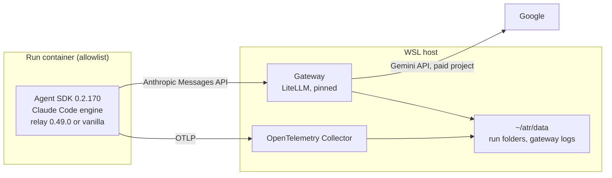

# Google models plan: relay and vanilla on Gemini

> **Status:** Deferred · **Last updated:** 2026-11-03 · **Owner:** Fabio Martins Barreto

**Deferred on 2026-11-03.** The owner decided not to run the Gemini tests for now ([D-056](../decisions/decision-log.md#d-056)). This plan is kept as future planning: nothing in it is built or run, no Google project is created, and the MVP continues as planned. Taking it up needs a new decision.

This plan prepares AI Track Record to run its tasks with Google's Gemini models and to compare the results with the runs on Claude models. It was written while the MVP waited: the included Anthropic API credits for November were used up, and the remaining MVP runs waited for the next allowance ([M3 results](../research/m3-results.md#running-the-batches)). The owner's Google AI plan includes monthly Google Cloud credits that pay for the Gemini API.

When it is taken up, it depends on:

- [D-031](../decisions/decision-log.md#d-031), **Proposed**: Claude Code reaches Gemini through a local gateway.
- [D-055](../decisions/decision-log.md#d-055), **Open**: whether Target A's content may be sent to Google's paid Gemini API.
- A decision to run it, with its scope and funding. The conditions proposed on 2026-11-02 are in [section 2](#2-relation-to-the-mvp).

## 1. Goal

Run the MVP's tasks with the same harness, workflow releases and limits, change only the model and its route, and grade the runs with the same graders. Each Gemini configuration can then be read against its counterpart in M3.

| # | Question | How it is answered |
|---|---|---|
| Q1 | Does relay, written and tuned for Claude, run unattended to the end on Gemini inside Claude Code? | Outcomes, halts and protocol deviations of relay on Gemini |
| Q2 | How do cost, time and quality change when the same workflow runs on Gemini instead of Claude? | Each Gemini configuration against its M3 counterpart |
| Q3 | Is relay worth its cost on Gemini, as the MVP asks for Claude? | Relay against vanilla, both on Gemini |

**Exit criterion:** the experiment's runs are executed, graded and analyzed in `documentation/research/gemini-results.md`, and every compatibility check ([section 7](#7-compatibility-checks)) has passed or has its failure recorded.

## 2. Relation to the MVP

Models from other providers are a Phase 2 item ([CFG-07](../product/03-capabilities.md#2-workflows-models-and-configurations), [roadmap](../product/06-scope-and-roadmap.md#5-phase-2-credibility-and-breadth)). Running them before the MVP is public is a broadening that the [conflict rules](../product/01-vision-and-scope.md#64-when-objectives-conflict) do not allow by default, so taking the plan up before then needs a new decision. The conditions proposed on 2026-11-02, kept for that decision, are:

- **The MVP does not change.** Its scope ([D-024](../decisions/decision-log.md#d-024)), configurations, ceiling ([D-028](../decisions/decision-log.md#d-028)) and dashboard stay as they are. The Gemini runs replace no MVP run.
- **Separate money.** The Gemini runs are paid only with the Google credits. They never draw on the MVP's US$ 800 ceiling, and the MVP never draws on the Google credits.
- **The MVP keeps priority.** MVP work that needs no API spend, such as the blind confirmation of the graded runs and the dashboard (M4), keeps first claim on the operator's time.
- **Publication waits.** Gemini results are published only after the MVP is public, labeled as workflow portability ([R9](../product/06-scope-and-roadmap.md#9-risks-and-mitigations)).

## 3. Decisions this plan relies on

| Decision | What it fixes for the Gemini runs |
|---|---|
| [D-017](../decisions/decision-log.md#d-017), [D-049](../decisions/decision-log.md#d-049) | The harness stays Claude Code through the Agent SDK. Gemini runs inside it; no other coding agent is used |
| [D-020](../decisions/decision-log.md#d-020) | Pinned inputs, three repetitions, one factor at a time, hypotheses declared before running, the same limits for all |
| [D-022](../decisions/decision-log.md#d-022) | Cost is computed from tokens and a dated price table, and its source is labeled |
| [D-026](../decisions/decision-log.md#d-026), [D-029](../decisions/decision-log.md#d-029), [D-055](../decisions/decision-log.md#d-055) | Which providers may receive Target A's content; Target A is Anthropic-only until D-055 says otherwise |
| [D-027](../decisions/decision-log.md#d-027) | API access meant for programmatic use; no free tier and no consumer app |
| [D-031](../decisions/decision-log.md#d-031) | How the harness reaches a non-Anthropic model |
| [D-018](../decisions/decision-log.md#d-018), [D-051](../decisions/decision-log.md#d-051), [D-053](../decisions/decision-log.md#d-053) | The same graders as the MVP: oracle, existing tests, static analysis, the pinned independent review and the skipped-step check |
| [D-050](../decisions/decision-log.md#d-050) | The network allowlist and disabled web tools on Target A |
| [D-054](../decisions/decision-log.md#d-054) | Relay 0.49.0 from the same copy of commit `cfe5e0b` as the MVP |

## 4. Access to Google's models

### 4.1 What the Google AI plan gives

Google's AI plans include the Google Developer Program's premium benefits. Among them is a monthly grant of Google Cloud credits: US$ 10, 40 or 100 a month, depending on the plan ([benefits FAQ](https://developers.google.com/profile/help/benefits), read on 2026-11-02).

- The credits are claimed onto a Google Cloud **billing account**, not a project, from the Developer Program's benefits page.
- Each grant expires a year after it is issued. Unlike the Max plan's API credits, which expire each billing cycle ([D-049](../decisions/decision-log.md#d-049)), unused grants add up over the months.
- They apply to Google Cloud products, including the Gemini API and Vertex AI.

The exact amount depends on the owner's plan and is confirmed in WP0.

### 4.2 Which route qualifies

The [Gemini API terms](https://aistudio.google.com/docs/terms) (effective 2026-03-23, read on 2026-11-02) separate paid and unpaid services. The API is a paid service when it is reached through a Cloud project with an active billing account. Paying that account with credits keeps it a billing account, so the runs fall under the paid terms; WP0 confirms that the project shows as paid.

| Route | Terms | Used here? |
|---|---|---|
| **Gemini API from a dedicated project linked to the billing account that holds the credits** | Paid service: Google does not use prompts or responses to improve its products. It logs them for a limited period to detect policy violations, and may store or cache them transiently in any country | **Yes**, for every Gemini run |
| Gemini API without billing (free tier) | Unpaid service: content is used to improve Google's products and may be read by human reviewers; the terms ask users not to submit confidential information | No: excluded by [D-027](../decisions/decision-log.md#d-027), and by [D-026](../decisions/decision-log.md#d-026) for Target A. The flagship model has no free tier anyway |
| Gemini CLI or Gemini Code Assist signed in with a personal Google account | Consumer terms | No: [D-027](../decisions/decision-log.md#d-027), and it is another harness ([D-017](../decisions/decision-log.md#d-017)) |
| Vertex AI | Google Cloud terms; the credits apply | Not needed for Gemini; see [section 13](#13-outside-this-plan) |

Target A's material is never pasted into AI Studio's web interface or any Gemini app.

### 4.3 Models and prices

From Google's [pricing](https://aistudio.google.com/docs/pricing) and [models](https://aistudio.google.com/docs/models) pages, read on 2026-11-02. Prices are in US$ per million tokens, standard tier, and output includes thinking tokens.

| Model ID | Status | Input | Output | Cache read | Price change | Role here |
|---|---|---|---|---|---|---|
| `gemini-4-argon` | Stable | 2.00 | 10.00 | 0.10, implicit caching only | Doubles on 2026-12-01: 4.00 · 20.00 · 0.20 | Large model, counterpart of Sonnet |
| `gemini-3.8-flash` | Stable | 0.75 | 3.75 | 0.075 | Doubles on 2027-01-01: 1.50 · 7.50 · 0.15 | Small model, counterpart of Haiku |

Both take 1,048,576 input tokens and 65,536 output tokens, and support function calling and thinking. `gemini-3.1-pro-preview` is left out because preview models change and have tighter rate limits ([D-020](../decisions/decision-log.md#d-020) pins inputs). Flash-Lite models can be added later as a third size.

### 4.4 Rate limits

Limits apply per project ([rate limits](https://aistudio.google.com/docs/rate-limits)). A project linked to an active billing account is on **Tier 1**. Tier 2 needs US$ 100 paid and three days; whether credits count as payment is not stated. Tier 1 also limits spend to **US$ 10 in any rolling 10 minutes**, and a request past that limit gets HTTP 429. The per-model request and token limits are shown only to a signed-in account and are recorded in WP0.

## 5. How the runs reach Gemini

Claude Code speaks only Anthropic's Messages API. A gateway on the operator's machine translates its requests for the Gemini API and translates the answers back ([D-031](../decisions/decision-log.md#d-031)). The proposed gateway is [LiteLLM](https://docs.litellm.ai/docs/anthropic_unified)'s proxy, which [documents this use](https://docs.litellm.ai/docs/tutorials/claude_non_anthropic_models). Anthropic documents gateways for Claude Code but [does not support](https://code.claude.com/docs/en/llm-gateway) non-Claude models behind one, which is why the results are labeled as workflow portability.

What stays the same as in the MVP: the Agent SDK and the engine it bundles, the relay copy, the vanilla instruction, the task images, the network allowlist, the time limit and the cost cap. What changes: the model, and the route from the run to the model.

### 5.1 The run's settings

- `ANTHROPIC_BASE_URL` points to the gateway, and `ANTHROPIC_AUTH_TOKEN` carries a gateway key made for that run. The run container gets **no Anthropic key**, so no request can reach Anthropic by mistake.
- `ANTHROPIC_MODEL`, `CLAUDE_CODE_SUBAGENT_MODEL` with `CLAUDE_CODE_SUBAGENT_MODEL_FORCE=1`, and `ANTHROPIC_DEFAULT_HAIKU_MODEL`, `ANTHROPIC_DEFAULT_SONNET_MODEL` and `ANTHROPIC_DEFAULT_OPUS_MODEL` all name the model under test, as the MVP runs force every sub-agent onto one model ([CFG-04](../product/03-capabilities.md#2-workflows-models-and-configurations)).
- Telemetry, privacy and stability settings are the MVP's.

### 5.2 The gateway

- **Only the experiment's models.** The gateway exposes exactly the aliases `gemini-4-argon` and `gemini-3.8-flash` and refuses any other model name, so a stray request fails visibly instead of reaching another model.
- **No fallbacks and no retries of its own.** Claude Code's own retry logic handles errors, as it does against Anthropic, and every 429 is recorded once.
- **Thinking.** Claude Code sends its adaptive thinking setting to models it does not know. The gateway sets each model's thinking level explicitly, and the level is recorded with the route.
- **Caching.** Claude Code marks cache points for Anthropic's prompt cache. `gemini-4-argon` supports only implicit caching, which Google applies by itself to repeated prompt prefixes. Cost depends heavily on it, since a cache read costs 5% of an input token.
- **One key per run.** The launcher creates a gateway key for each run, named after the trial and limited to the run's cost cap. The gateway's spend log attributes every request to its run by that key.
- **A local record.** After each run, the launcher writes the run's gateway requests (model, tokens including cached tokens, latency, status) into the trial folder, so run folders stay the system of record ([D-033](../decisions/decision-log.md#d-033)). The gateway keeps no prompt or response text.
- **Nothing leaves the machine but the model calls.** No logging callbacks, no usage telemetry, and prices come from a local table instead of the gateway's online price list.
- **Security.** LiteLLM is pinned to a release checked against its security advisories and installed from verified hashes, never one of the compromised packages of 2026 ([D-031](../decisions/decision-log.md#d-031), [R11](../product/06-scope-and-roadmap.md#9-risks-and-mitigations)). It listens only where the run containers reach it, and its master key and the Google API key live in `~/atr/.env`. Its configuration, without secrets, lives in `infra/llm-gateway/`.

### 5.3 Network

On Target A, the run's allowlist names the gateway instead of Anthropic's API, plus the Collector and the package index ([D-050](../decisions/decision-log.md#d-050)). The run container never talks to Google: only the gateway does, from the WSL host, outside the allowlist, as the Collector does.

## 6. Harness changes

| Component | Change | Why |
|---|---|---|
| Agent (`atr/agents/claude_sdk.py`) | A route option: with a gateway, the agent passes its URL and the run's key instead of the Anthropic key, and pins every model alias to the model under test. It writes `agent/route.json` with the provider, the gateway's version and configuration digest, the upstream model ID and the thinking level | [RUN-04](../product/03-capabilities.md#4-execution) records provider routes; [D-020](../decisions/decision-log.md#d-020) pins them |
| Task templates | An allowlist variant that names the gateway instead of Anthropic's API | [D-050](../decisions/decision-log.md#d-050) |
| Price table | A dated price table in the repository, with the Gemini prices of section 4.3 and their change dates, and the Claude prices used so far | Claude Code's cost estimate and the SDK's budget cap do not know Gemini's prices ([TEL-03](../product/03-capabilities.md#5-telemetry), [D-022](../decisions/decision-log.md#d-022)) |
| Run cap | The cap of US$ 60 per run is enforced by the run's gateway key; the SDK's cap stays as a second guard. A run stopped by its key ends as `budget_exceeded` | [RUN-03](../product/03-capabilities.md#4-execution), [D-019](../decisions/decision-log.md#d-019) |
| Store (`atr/store/load.py`) | Loads the gateway record of each run into `model_usage`, with its source; computes cost from the price table; adds the gateway as a fourth source to the reconciliation; counts 429 answers and the time waited for them | [D-022](../decisions/decision-log.md#d-022), [D-032](../decisions/decision-log.md#d-032) |
| Budget (`atr/ops/budget.py`) | A ceiling per experiment, so Gemini jobs are summed against the Google credits and not against the MVP's US$ 800 | [Section 2](#2-relation-to-the-mvp) |
| Export (`atr/store/export.py`) | Exports the route and provider, labels Gemini runs as workflow portability, and keeps them out of the MVP export | [R9](../product/06-scope-and-roadmap.md#9-risks-and-mitigations), [section 2](#2-relation-to-the-mvp) |

Gemini jobs use their own prefix, `gm-`, as the MVP's use `m3-`. The graders need no change: the oracle, the existing tests, static analysis, the skipped-step check and the review read the run's changes and records, not the model. Check G4 confirms it.

## 7. Compatibility checks

The checks run on the public synthetic task first ([D-046](../decisions/decision-log.md#d-046)), so debugging transcripts expose nothing private. Target A's pilots come only after they pass.

| # | Check | Passes when |
|---|---|---|
| G1 | **Request translation** | A request through the gateway with streaming, adaptive thinking, a `system` message, tools, a tool result and cache markers gets a complete streamed answer from each model, with no HTTP 400 |
| G2 | **Model forcing** | In a relay run, every request of the main session and of every sub-agent reaches the model under test; the gateway refuses a request for any other model sent on purpose |
| G3 | **Long tool loops** | A relay run on `gemini-3.8-flash` finishes its protocol with no error about missing thought signatures, no malformed tool call and no stalled stream. Gemini needs its thought signatures returned on later tool turns; LiteLLM documents this for its chat path but not for the Messages path |
| G4 | **Graders unchanged** | The run is graded by the same verifier, static analysis, skipped-step check and review, with no change to them |
| G5 | **Tokens and cost** | Per run, the gateway record, Claude Code's events and the SDK's usage agree on input and output tokens, and cached tokens are reported. Over the check runs, cost computed from the price table matches Google's billing report within 10% ([SC-3](../product/06-scope-and-roadmap.md#mvp-success-criteria)) |
| G6 | **Caching** | Cache reads are a large share of the input tokens of a relay run, comparable with the share on Claude runs. If not, the budget in section 10 is redone before any Target A run |
| G7 | **Rate limits** | A 429 reaches Claude Code with its retry delay, the run continues, and the store records the count and the time waited |
| G8 | **Budget cap** | A run whose key reaches a low test cap stops and ends as `budget_exceeded` |
| G9 | **Network** | From the run container, only the gateway, the Collector and the package index answer; Anthropic's and Google's APIs do not |
| G10 | **Gateway parity on Claude** (optional) | A vanilla run on Sonnet through the gateway sends the same request bodies as a direct run, apart from authentication, and its usage matches. It costs under US$ 1 of Anthropic credits and estimates the effect of the route alone |

## 8. Experiment design

### 8.1 Configurations

Each Gemini configuration differs from an MVP configuration in the model and its route only.

| Configuration | Workflow | Model | MVP counterpart | Question |
|---|---|---|---|---|
| **G-Large** | relay 0.49.0 | `gemini-4-argon` | Reference: relay on Sonnet 5.5 | Q1, Q2 |
| **G-Small** | relay 0.49.0 | `gemini-3.8-flash` | Smaller model: relay on Haiku 5.5 | Q1, Q2 |
| **G-Baseline** | vanilla | `gemini-4-argon` | Baseline: vanilla on Sonnet 5.5 | Q2, and Q3 against G-Large |
| G-Baseline-Small (if the credits allow) | vanilla | `gemini-3.8-flash` | Vanilla on Haiku, from the M2 pilots only | Q3 against G-Small |

Three tasks on Target A × three configurations × three repetitions = **27 runs**, or 36 with the fourth configuration, plus pilots and retries. If [D-055](../decisions/decision-log.md#d-055) keeps Target A on Anthropic only, the same configurations run on the synthetic task, and the comparison is with the Phase 0 runs, which used relay 0.47.0.

Every run has the MVP's limits: three hours, a cost cap of US$ 60 and web tools disabled. Runs go one at a time, by repetition, in the order drawn for each repetition, as in [M3](../research/m3-results.md#running-the-batches). A shortfall of credits then cuts runs of the last repetition, not a configuration.

### 8.2 Hypotheses

A draft, to be declared by the owner in WP4, before the pilots ([D-020](../decisions/decision-log.md#d-020)):

| # | Hypothesis | Measured by |
|---|---|---|
| HG1 | Relay 0.49.0 completes its protocol on `gemini-4-argon` on most runs, but records more deviations than on Sonnet, since its prompts were written for Claude | Outcomes and the skipped-step check, G-Large against the reference |
| HG2 | Relay on `gemini-3.8-flash` halts or deviates more often than relay on Haiku | Outcomes and the skipped-step check, G-Small against the smaller model |
| HG3 | Vanilla on `gemini-4-argon` meets the oracle on every task, as vanilla on Sonnet and Haiku did | Rewards of G-Baseline |
| HG4 | Relay on Gemini costs at least ten times as much as vanilla on Gemini for the same oracle result, as the MVP expects for Sonnet (H2 of M3) | Cost and reward, G-Large against G-Baseline |
| HG5 | The quality graders differ less between providers than cost and time do | Graders across the paired configurations |

## 9. Comparing the metrics

Every MVP metric is computed for the Gemini runs. Not all of them compare across providers in the same way.

| Metric | Across providers | How |
|---|---|---|
| Oracle result, criteria satisfied, regressions | Yes | Same frozen tasks and oracles |
| New static findings | Yes | Same tools and configuration |
| Review findings, and the confirmed share | Yes, with a caveat | The reviewer stays Claude Code's `/code-review` on Sonnet 5.5 for every run ([D-018](../decisions/decision-log.md#d-018)). A reviewer may favor its own model family, so the blind human confirmation covers one run per configuration and task, as in the MVP |
| Outcomes, halts and protocol deviations | Yes | Same normalized outcomes ([D-019](../decisions/decision-log.md#d-019)) and the same skipped-step check ([D-051](../decisions/decision-log.md#d-051)) |
| Cost | Yes, from one price table | Comparisons use one dated price table for all runs, stated next to the numbers, so a run made before 2026-12-01 is not cheaper only because of Argon's introductory price. Reconciliation with billing uses the prices in force on the day of each run |
| Wall-clock time | With care | Provider latency and rate limits differ. API time and the time waited on 429 answers are shown next to it |
| Tokens | No | Gemini and Claude count tokens with different tokenizers. Tokens are stored and shown per run, but cost carries the comparison |
| Turns, tool calls, size of the changes | Yes | Same harness and the same counting |

Every comparison is labeled as a small sample ([D-020](../decisions/decision-log.md#d-020)) and as workflow portability: the results describe relay and Claude Code running on Gemini through a gateway, not Gemini's ability as a coding agent ([measurement limitations](../product/04-measurement.md#9-known-limitations)).

## 10. Budget

Planning assumptions from list prices, not measurements: a Gemini run uses about as many tokens as its MVP counterpart, and Gemini's implicit cache hits about as often as Anthropic's prompt cache. The pilots of WP5 replace these numbers, as the M0 and M2 pilots did for the MVP.

| Configuration | Per run | 9 runs |
|---|---|---|
| G-Large, relay on `gemini-4-argon` | US$ 8–12 until 2026-11-30; US$ 16–24 from 2026-12-01 | US$ 145–215 at December prices |
| G-Small, relay on `gemini-3.8-flash` | US$ 4–7 until 2026-12-31 | US$ 35–65 |
| G-Baseline, vanilla on `gemini-4-argon` | under US$ 1 | under US$ 9 |
| G-Baseline-Small, vanilla on `gemini-3.8-flash` | under US$ 0.50 | under US$ 5 |
| Compatibility checks and two pilots | | US$ 15–35 |

The experiment comes to about **US$ 200–330**, or about US$ 220–360 with one retry in ten. If implicit caching rarely hits (G6), relay runs could cost several times more. The reviews add about US$ 0.40 per run on Anthropic credits, about US$ 11–15, paid from a later Anthropic allowance and counted with this experiment.

**Repricing check (2026-11-03).** The token volumes of the 20 Claude runs on Target A in the store, repriced at Gemini's list prices, replace the assumptions above. Each Gemini configuration takes the tokens of its counterpart: fresh input and cache writes at the input price, cache reads at the cache price.

| Configuration | Counterpart's runs | Per run | 9 runs: November · December · from 2027 |
|---|---|---|---|
| G-Large | Relay 0.49.0 on Sonnet, 4 runs | US$ 8–16 until 2026-11-30; US$ 17–32 from 2026-12-01 | US$ 94 · 189 · 189 |
| G-Small | Relay 0.49.0 on Haiku, 4 runs | US$ 1–11; twice that from 2027 | US$ 56 · 56 · 112 |
| G-Baseline | Vanilla on Sonnet, 6 runs | US$ 0.40–0.50; US$ 0.80–1.05 from 2026-12-01 | US$ 4 · 8 · 8 |
| G-Baseline-Small | Vanilla on Haiku, 3 runs | US$ 0.60–0.75; twice that from 2027 | US$ 6 · 6 · 12 |

The 36 runs come to about **US$ 160 in November, 260 in December and 320 from 2027**, plus US$ 40–70 for checks, pilots and retries. The same cells cost about US$ 135 on Claude. These figures assume Gemini's implicit cache hits the reads Anthropic's cache hit. Cache reads are about half the cost of a relay run, so every 10 points of reads that miss add about 95% to relay on Argon and about 45% on Flash. With no hit at all, a relay run on Argon would cost US$ 160–360 at December prices and stop at the US$ 60 cap.

It runs in stages that follow the credit grants:

| Stage | Content | Estimate | With US$ 10 a month | With US$ 40 a month | With US$ 100 a month |
|---|---|---|---|---|---|
| A | Compatibility checks, then G-Baseline and G-Baseline-Small | US$ 20–50 | 2–5 months | 1 month | 1 month |
| B | Pilot and runs of G-Small | US$ 40–75 | not practical | 1–2 months | 1 month |
| C | Pilot and runs of G-Large | US$ 160–240 | not practical | 4–6 months | 2–3 months |

Spend past the credits granted needs a new decision. The billing account has a payment method, so the gateway's keys and the harness's budget check are what stop it; a Cloud Billing budget alert at the credit amount is the third guard.

## 11. Work packages

Target dates are set when the plan is taken up.

| WP | Content | Who | Effort | Done when |
|---|---|---|---|---|
| **0** | Confirm the plan's monthly credit; claim it onto a billing account; create a dedicated Cloud project linked to it; enable the Gemini API; create an API key limited to that API and project; record the project's tier and its per-model limits; set a billing budget alert; store the key in `~/atr/.env` | Operator | 0.5–1 h | The project shows as paid on Tier 1, the credits show on the billing account, and a test request answers |
| **1** | The gateway in `infra/llm-gateway/`: pinned LiteLLM and its database, the two aliases, thinking levels, local prices, keys per run, no prompt logging, no callbacks | Session | 3–5 h | Check G1 passes |
| **2** | The harness changes of section 6 | Session | 5–8 h | A vanilla run on `gemini-3.8-flash` on the synthetic task is graded, loaded and reconciled |
| **3** | Checks G2 to G10 on the synthetic task, and the fixes they call for | Session, with the operator | 3–5 h, plus machine time | Every check has a result; failures have a fallback chosen ([section 12](#12-risks-and-fallbacks)) |
| **4** | Owner decisions: taking the plan up, [D-031](../decisions/decision-log.md#d-031) and [D-055](../decisions/decision-log.md#d-055); declare the hypotheses; draw the run order | Operator | 1 h | Decisions and hypotheses recorded |
| **5** | Two pilots on Target A: G-Small on task 01 and G-Large on task 03, the cells used for the M3 pilots; redo the budget with their costs | Operator, with a session | 1–2 h, plus machine time | Both pilots graded; the budget recalibrated |
| **6** | The batches, by repetition, stage by stage as the credits allow | Operator | 3–5 h, plus about 30 h of machine time | Every planned run has a result or a recorded reason |
| **7** | Reviews of every run and the blind confirmation of one run per configuration and task, when Anthropic credits allow | Operator, with a session | 2–3 h | Reviews stored and confirmations graded |
| **8** | Analysis and the results report, `documentation/research/gemini-results.md` | Session, with the operator | 3–5 h | The report answers Q1 to Q3 and the hypotheses |

**Total: about 22–35 hours of operator time**, which competes with M3's remaining work and M4's 15–22 hours. The MVP keeps priority ([section 2](#2-relation-to-the-mvp)), so these packages use the hours the MVP cannot.

## 12. Risks and fallbacks

| Risk | Fallback |
|---|---|
| The gateway cannot translate some of Claude Code's requests (G1, G3) | A newer LiteLLM release; then [claude-code-router](https://github.com/musistudio/claude-code-router); then a minimal translator of our own. If none works, relay cannot be measured on Gemini through Claude Code, and only that finding is recorded |
| Implicit caching rarely hits through the gateway (G6) | Redo the budget; run Stage A and B only; consider Vertex AI's explicit caching in a later plan |
| Relay halts on Gemini for reasons of the route, not of the workflow | Each halt is read against the gateway record; route errors are infrastructure errors ([D-019](../decisions/decision-log.md#d-019)) and the run is retried, while workflow halts count as results |
| Tier 1's spend limit of US$ 10 per 10 minutes slows relay runs | The waits are recorded and shown with the time metrics; Tier 2 comes with spend |
| Introductory prices end (2026-12-01 for Argon, 2027-01-01 for Flash) | Comparisons use one price table, so published numbers do not depend on the run date. Only billing does |
| Google changes a model behind its ID during the experiment | Stable model IDs only; the model version Google reports is recorded with every request |
| D-055 keeps Target A on Anthropic only | The experiment runs on the synthetic task and says so |
| The work delays the MVP | The MVP keeps priority; this plan pauses, its scope does not grow into the MVP ([D-043](../decisions/decision-log.md#d-043)) |
| The gateway itself is compromised or exposed | Pinned and verified release, listening only for the run containers, secrets outside the repository, keys per run ([R11](../product/06-scope-and-roadmap.md#9-risks-and-mitigations)) |

## 13. Outside this plan

- **Claude on Vertex AI, paid with the Google credits.** Vertex AI also serves Claude models, so the Google credits might pay for the MVP's own remaining runs. Whether the credits cover partner models is not stated, and it would send Target A's content to Google as a new processor ([D-029](../decisions/decision-log.md#d-029)) and change the route of MVP configurations in the middle of the experiment ([D-020](../decisions/decision-log.md#d-020)). It would need its own decision.
- **Gemini CLI as a harness.** It would change the harness and the model at once, and relay cannot run in it. Other harnesses are a Phase 3 extension ([CFG-09](../product/03-capabilities.md#2-workflows-models-and-configurations)).
- **Open-weight and other providers' models.** The same gateway can route to them later ([D-031](../decisions/decision-log.md#d-031)).

## 14. Outputs

- The gateway configuration in `infra/llm-gateway/`, without secrets.
- The harness changes of section 6, with the price table.
- The compatibility checks' results and the Gemini runs in the local store.
- A results report, `documentation/research/gemini-results.md`.
- Updated decisions: D-031 and D-055, and the decision that takes the plan up.
