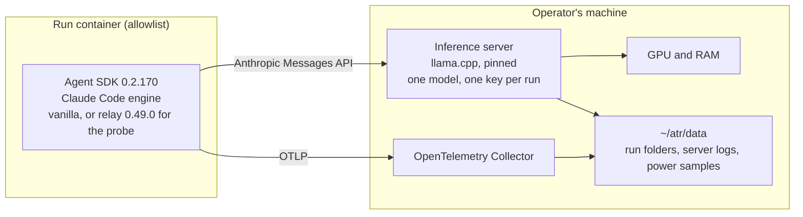

# Local models plan: open-weight models on the operator's machine

> **Status:** Draft · **Last updated:** 2026-11-03 · **Owner:** Fabio Martins Barreto

This plan prepares AI Track Record to run its tasks with open-weight models that run on the operator's own machine, and to compare the results with the runs on Claude models. It was written on 2026-11-03 at the owner's request, while the MVP waited for the next Anthropic API allowance ([M3 results](../research/m3-results.md#running-the-batches)), and taken up the same day. Nothing in it is built or run yet.

It depends on:

- [D-031](../decisions/decision-log.md#d-031), **Proposed**: how the harness reaches non-Anthropic models. This plan adds the local route, decided in WP4.
- [D-057](../decisions/decision-log.md#d-057), **Accepted**: Target A's content may be processed by open-weight models running on the operator's machine.
- [D-058](../decisions/decision-log.md#d-058), **Accepted**: this experiment runs outside the frozen MVP, under the conditions of [section 2](#2-relation-to-the-mvp-and-to-the-google-models-plan).

## 1. Goal

Run Target A's tasks with the same harness, the same limits and the same graders as the MVP. Change only the model and its route, and read each local configuration against the vanilla runs on Claude.

| # | Question | How it is answered |
|---|---|---|
| QL1 | Can vanilla Claude Code complete Target A's tasks with an open-weight model running on this machine, and how do its grades compare with vanilla on Sonnet and Haiku? | Oracle, criteria, regressions, static findings and reviews of each local configuration against the vanilla runs on Claude |
| QL2 | Does the hidden oracle separate configurations at all? All nine vanilla runs on Claude so far, the M2 pilots and the first M3 repetition, met every criterion ([M2 results](../research/m2-results.md#precise-specifications-make-the-tasks-easy-for-a-strong-model)) | The spread of rewards across the local configurations |
| QL3 | What does a local run cost in machine time and energy, next to the API cost of its Claude counterpart? | Wall-clock time, server speeds and energy of each local run |
| QL4 | Can relay run unattended on a local model within the MVP's limits? | One relay run on the synthetic task |

**Exit criterion:** the experiment's runs are executed, graded and analyzed in `documentation/research/local-results.md`, and every compatibility check ([section 8](#8-compatibility-checks)) has passed or has its failure recorded.

## 2. Relation to the MVP and to the Google models plan

Open-weight models are a Phase 2 item ([CFG-07](../product/03-capabilities.md#2-workflows-models-and-configurations), [roadmap](../product/06-scope-and-roadmap.md#5-phase-2-credibility-and-breadth)). Running them before the MVP is public is a broadening that the [conflict rules](../product/01-vision-and-scope.md#64-when-objectives-conflict) do not allow by default, so [D-058](../decisions/decision-log.md#d-058) takes it up under these conditions:

- **The MVP does not change.** Its scope ([D-024](../decisions/decision-log.md#d-024)), configurations, ceiling ([D-028](../decisions/decision-log.md#d-028)) and dashboard stay as they are. The local runs replace no MVP run.
- **The MVP keeps priority, over the operator's time and over the machine.** No local run starts while an MVP job is running: both load the same machine, and time is one of the graders. When the MVP batches resume, this plan pauses.
- **No API spend except the reviews.** The models cost nothing per token. The independent reviews, about US$ 0.40 per run on Anthropic credits, are counted with this experiment and never against the MVP's US$ 800.
- **Publication waits.** Local results are published only after the MVP is public, labeled as workflow portability ([R9](../product/06-scope-and-roadmap.md#9-risks-and-mitigations)).

The [Google models plan](google-models.md), deferred by [D-056](../decisions/decision-log.md#d-056), needs the same harness changes: a route option, a route record, route columns in the store and export labels ([section 7](#7-harness-changes)). This plan builds them first, and the Google plan reuses them if it is taken up. It needs no gateway, no money and no third party, so it does not wait on [D-055](../decisions/decision-log.md#d-055).

## 3. Decisions this plan relies on

| Decision | What it fixes for the local runs |
|---|---|
| [D-017](../decisions/decision-log.md#d-017), [D-049](../decisions/decision-log.md#d-049) | The harness stays Claude Code through the Agent SDK. The local models run inside it; no other coding agent is used |
| [D-020](../decisions/decision-log.md#d-020) | Pinned inputs, three repetitions, one factor at a time, hypotheses declared before running, the same limits for all |
| [D-026](../decisions/decision-log.md#d-026), [D-029](../decisions/decision-log.md#d-029), [D-057](../decisions/decision-log.md#d-057) | Who may process Target A's content. D-057 allows local models on Target A, and the runs reach it only after the checks of [section 8](#8-compatibility-checks) pass on the synthetic task |
| [D-031](../decisions/decision-log.md#d-031) | How the harness reaches a non-Anthropic model |
| [D-018](../decisions/decision-log.md#d-018), [D-051](../decisions/decision-log.md#d-051), [D-053](../decisions/decision-log.md#d-053) | The same graders as the MVP: oracle, existing tests, static analysis, the pinned independent review and the skipped-step check |
| [D-046](../decisions/decision-log.md#d-046) | The public synthetic task, used for the checks and the relay probe |
| [D-050](../decisions/decision-log.md#d-050) | The network allowlist and disabled web tools on Target A |
| [D-054](../decisions/decision-log.md#d-054) | Relay 0.49.0 from the same copy of commit `cfe5e0b` as the MVP, for the relay probe |

## 4. The machine

The experiment is designed for the machine that runs the MVP, as it was on 2026-11-03:

| Part | What it has |
|---|---|
| GPU | NVIDIA GeForce RTX 3060 Ti, 8 GB of VRAM, 225 W power limit. The Windows desktop used about 1.9 GB of it |
| CPU | AMD Ryzen 5 5600G, 6 cores and 12 threads, with integrated graphics |
| RAM | 27.9 GB visible to Windows. The WSL 2 VM, which Docker Desktop shares, is capped at 18 GB and 10 processors |
| Disk | 21 GB free on C:, 453 GB free on D: |

What follows from it:

- **Only small models fit in VRAM.** A model of about 9B parameters at 4 bits runs entirely on the GPU. Mixture-of-experts models with 3–4B active parameters run with their expert weights in RAM, through llama.cpp's `--n-cpu-moe`. RAM, not VRAM, decides which of them fit.
- **The desktop takes VRAM.** During local sessions the display moves to the integrated graphics, or the apps that use the GPU are closed. The VRAM in use at the start of each run is recorded.
- **The VM needs more memory for local sessions.** A 35B-A3B model at 3 bits needs about 17 GB of RAM and VRAM together, and at 4 bits about 23 GB ([Unsloth](https://unsloth.ai/docs/models/tutorials/qwen3.6.md), read on 2026-11-03). Local sessions use a WSL profile with more memory, about 22–24 GB, recorded with each run and replaced by the MVP's profile when the MVP batches resume.
- **Weights live on D:.** C: has no room for them. The server loads each model fully into memory at start, so inference never reads weights from disk.

## 5. Models

### 5.1 What the runs need

The Target A runs in the local store give the volume a local model has to handle. Pilots and MVP runs only, without check runs; medians per run. Token counts use Claude's tokenizer, and fresh input is input plus cache writes.

| Configuration (runs) | Output tokens | Fresh input | Cache reads | Requests | Median context | Largest request | Wall time |
|---|---|---|---|---|---|---|---|
| Vanilla on Sonnet 5.5 (6) | 22k | 76k | 0.7M | 13 | 66k | 94k | 3 min |
| Vanilla on Haiku 5.5 (3, M2 pilots) | 80k | 144k | 3.8M | 37 | 120k | 165k | 8 min |
| Relay 0.49.0 on Sonnet 5.5 (4) | 211k | 1.4M | 50M | 229 | 189k | 690k | 32 min |
| Relay 0.49.0 on Haiku 5.5 (4) | 570k | 2.2M | 53M | 356 | 94k | 593k | 54 min |

The smaller model read and wrote more: vanilla on Haiku made almost three times as many requests as on Sonnet, with larger contexts. A local model is likely closer to Haiku than to Sonnet here, so the estimates below start from Haiku's row. Two consequences:

- **Vanilla needs a context of 128k tokens or more.** On Haiku, half of the requests carried more than 120k tokens and the largest 165k. A smaller window makes Claude Code compact the conversation more often than on Claude.
- **Relay does not fit.** At the speeds of [section 11](#11-budget), relay's output alone takes several hours, and its largest requests are several times what this machine can hold. Relay therefore gets a single probe on the small synthetic task, not a configuration ([section 9](#9-experiment-design)).

### 5.2 Candidates

From the model cards and GGUF repositories on Hugging Face, read on 2026-11-03. All four are under Apache 2.0.

| Model | Released | Parameters | Context | GGUF | Size | Role |
|---|---|---|---|---|---|---|
| [Qwen3.6-35B-A3B](https://huggingface.co/Qwen/Qwen3.6-35B-A3B) | April 2026 | 35B, 3B active; mixture of experts; one layer in four has full attention | 262,144 | [Unsloth](https://huggingface.co/unsloth/Qwen3.6-35B-A3B-GGUF) UD-Q3_K_XL | 16.8 GB (UD-IQ3_XXS: 13.2 GB; UD-Q4_K_XL: 22.4 GB) | **L-MoE** |
| [Qwen3.5-9B](https://huggingface.co/Qwen/Qwen3.5-9B) | February 2026 | 9B, dense; one layer in four has full attention | 262,144 | [Unsloth](https://huggingface.co/unsloth/Qwen3.5-9B-GGUF) Q4_K_M | 5.68 GB | **L-Small** |
| [gpt-oss-20b](https://huggingface.co/openai/gpt-oss-20b) | August 2025 | 21B, 3.6B active; mixture of experts; harmony format | not checked | [ggml-org](https://huggingface.co/ggml-org/gpt-oss-20b-GGUF) MXFP4 | 12.1 GB | Candidate for L-Alt |
| [Gemma 4 26B-A4B](https://huggingface.co/google/gemma-4-26B-A4B-it) | 2026 | 25.2B, 3.8B active; mixture of experts; sliding-window and global attention | 256k | [Unsloth](https://huggingface.co/unsloth/gemma-4-26B-A4B-it-GGUF) UD-Q3_K_XL | 12.9 GB (UD-Q4_K_XL: 17 GB) | Candidate for L-Alt |

Left out:

- **Dense models of 24–32B**, such as Qwen3.6-27B: most of their layers would run on the CPU, at a few tokens per second.
- **Larger mixtures of experts**, such as the 80B-A3B class: they need more RAM than the machine has ([section 14](#14-outside-this-plan)).
- **Models served only through a provider's API**: they belong to a gateway route ([D-031](../decisions/decision-log.md#d-031)), like the Google plan.

The quantization and the context are chosen in WP0: the largest quantization that fits with a context of at least 128k tokens, aiming for about 160k, and leaves the run containers their memory. Results describe a quantized model on consumer hardware, not the model at full precision.

### 5.3 Sampling and thinking

Each model runs in its card's recommended setting for coding, with thinking on. For the Qwen models that is temperature 0.6, top-p 0.95, top-k 20, min-p 0 and no presence penalty; Gemma 4 uses temperature 1.0, top-p 0.95 and top-k 64. Claude Code sends its own thinking setting and may send sampling parameters, so check L1 records the parameters the server actually applied, and they are stored with the route.

## 6. How the runs reach the model

llama.cpp's server has accepted Anthropic's Messages API since [January 2026](https://huggingface.co/blog/ggml-org/anthropic-messages-api-in-llamacpp), with streaming, tool use, thinking and token counting. Claude Code can therefore point straight at it, with no gateway. Anthropic [does not support](https://code.claude.com/docs/en/llm-gateway) non-Claude models behind Claude Code, which is why the results are labeled as workflow portability.

Nothing in the diagram leaves the machine. What stays the same as in the MVP: the Agent SDK and the engine it bundles, the relay copy, the vanilla instruction, the task images, the time limit and the web tools disabled. What changes: the model, its route and the allowlist entry for the model API.

### 6.1 The run's settings

From Claude Code's [model configuration](https://code.claude.com/docs/en/model-config), [environment variables](https://code.claude.com/docs/en/env-vars) and [gateway protocol](https://code.claude.com/docs/en/llm-gateway-protocol) pages, read on 2026-11-03:

- `ANTHROPIC_BASE_URL` points to the server, and `ANTHROPIC_AUTH_TOKEN` carries the server's key for that run. The run container gets **no Anthropic key**.
- `ANTHROPIC_MODEL`, `ANTHROPIC_DEFAULT_OPUS_MODEL`, `ANTHROPIC_DEFAULT_SONNET_MODEL`, `ANTHROPIC_DEFAULT_HAIKU_MODEL`, `ANTHROPIC_DEFAULT_FABLE_MODEL`, and `CLAUDE_CODE_SUBAGENT_MODEL` with `CLAUDE_CODE_SUBAGENT_MODEL_FORCE=1`, all name the model under test, as the MVP runs force every sub-agent onto one model ([CFG-04](../product/03-capabilities.md#2-workflows-models-and-configurations)). Without the Fable alias, a request for it would name a Claude model.
- `CLAUDE_CODE_MAX_CONTEXT_TOKENS` and `CLAUDE_CODE_AUTO_COMPACT_WINDOW` are set to the server's context. Claude Code assumes a 200K window for a model it does not know, and the server would reject a longer request instead of letting Claude Code compact.
- Long prompt processing can outlast the five minutes Claude Code waits on an idle stream behind a custom base URL ([network configuration](https://code.claude.com/docs/en/network-config)). The idle timeouts are raised or turned off, and the values are recorded.
- Output stays at Claude Code's default of 32,000 tokens for a model it does not know, unless check L4 shows that it crowds the window.
- Telemetry, privacy and stability settings are the MVP's.

### 6.2 The inference server

- **Pinned.** llama.cpp's CUDA server image, pinned by digest with its build number, runs in Docker like the Collector. Qwen3.6 is not run on a CUDA 13.2 build, which Unsloth warns gives garbled output.
- **Pinned weights.** Each GGUF is downloaded once in WP0 from the publisher's or a named quantizer's repository, and its SHA-256 is recorded. The server runs in offline mode and never downloads at run time.
- **One server per run.** The launcher starts the server before each run with a new key and stops it after, so no run inherits another's cache. The load time is not part of the run.
- **One model.** The server loads only the model under test and logs the model name of each request, so a request for any other name shows up.
- **Recorded flags.** Context size, layers on the GPU, experts on the CPU, KV cache type, flash attention, number of slots, the RAM given to the prompt cache (8 GiB by default, which this machine must budget) and sampling.
- **A local record.** After each run, the launcher writes the server's log, its `/metrics` and `/slots` snapshots and the GPU power samples into the trial folder, so run folders stay the system of record ([D-033](../decisions/decision-log.md#d-033)). The server writes no prompt or response text outside the run folder.
- **Nothing leaves the machine.** The server is published only on the host's loopback, where the run containers reach it, and has no telemetry. Its configuration, without keys or weights, lives in `infra/local-inference/`.

### 6.3 Network

On Target A, the run's allowlist names `host.docker.internal` and the package index, without Anthropic's API ([D-050](../decisions/decision-log.md#d-050)). `host.docker.internal` already serves the Collector; the server is reached on the same host. Harbor's allowlist names hosts, not ports.

## 7. Harness changes

| Component | Change | Why |
|---|---|---|
| Agent (`atr/agents/claude_sdk.py`) | A route option: on the local route, the agent passes the server's URL and the run's key instead of the Anthropic key, sets the variables of section 6.1, and checks before the run that the server answers with the model under test. It writes `agent/route.json` with the provider, the server's image digest and build, the model file and its SHA-256, the quantization, the server flags, the sampling, the machine and the WSL profile | [RUN-04](../product/03-capabilities.md#4-execution) records provider routes; [D-020](../decisions/decision-log.md#d-020) pins them |
| Launcher | Starts and stops the server around each run with a new key; samples GPU power every second; copies the server's records into the trial folder; refuses to start a local run while an MVP job is running | Section 6.2; [section 2](#2-relation-to-the-mvp-and-to-the-google-models-plan) |
| Task templates | An allowlist variant without Anthropic's API | [D-050](../decisions/decision-log.md#d-050) |
| Store (`atr/store/load.py`) | Loads the route and the power samples; keeps the server's token counts as a third source in the reconciliation; records no API cost for local runs and adds machine time and energy | [TEL-03](../product/03-capabilities.md#5-telemetry), [D-022](../decisions/decision-log.md#d-022), [D-032](../decisions/decision-log.md#d-032) |
| Budget (`atr/ops/budget.py`) | Local jobs never count against the MVP's ceiling; their reviews are counted with this experiment | [Section 2](#2-relation-to-the-mvp-and-to-the-google-models-plan) |
| Export (`atr/store/export.py`) | Exports the route, the provider and the machine, labels local runs as workflow portability on a quantized model, and keeps them out of the MVP export | [R9](../product/06-scope-and-roadmap.md#9-risks-and-mitigations) |

Local jobs use their own prefix, `lc-`, as the MVP's use `m3-`. The graders need no change: they read the run's changes and records, not the model. Check L6 confirms it.

## 8. Compatibility checks

The checks run on the public synthetic task first ([D-046](../decisions/decision-log.md#d-046)), so debugging transcripts expose nothing private. Target A's pilots come only after they pass.

| # | Check | Passes when |
|---|---|---|
| L1 | **Request translation** | A request with streaming, thinking, a `system` message, Claude Code's full tool set, a tool result and cache markers gets a complete streamed answer from each model, with no HTTP error. The server's slots show the sampling it applied, and its log holds no prompt text |
| L2 | **Model forcing** | In a vanilla run and in the relay probe, every request of the main session, of every sub-agent and of Claude Code's background calls names the model under test |
| L3 | **Tool calls** | A vanilla run on the synthetic task ends with no malformed tool call and no stalled stream. Malformed calls are counted from the transcript |
| L4 | **Context and compaction** | Claude Code compacts before the server's window is full; no request fails with a context error. A prompt close to the server's window is processed without hitting an idle timeout |
| L5 | **Prefix reuse** | Between consecutive turns of the main session, the server processes only the new part of the prompt. Models with recurrent or sliding-window layers may reuse less; if part of the prompt that Claude Code sends early changes from request to request, the setting that stops it is found and recorded |
| L6 | **Graders unchanged** | The run is graded by the same verifier, static analysis, skipped-step check and review, with no change to them |
| L7 | **Tokens** | Per run, the server's record, Claude Code's events and the SDK's usage agree on input and output tokens |
| L8 | **Cost and caps** | The SDK's cost for a model it does not know is recorded as it is (Claude Code has no price for it), and the USD cap neither stops a run by mistake nor stands in for a limit. The time limit and turn limit stop runs as in the MVP |
| L9 | **Network** | From the run container, only `host.docker.internal` and the package index answer; Anthropic's API does not |
| L10 | **Stability** | The server stays up through a three-hour run without running out of VRAM or RAM. A server failure ends the run as an infrastructure error ([D-019](../decisions/decision-log.md#d-019)) |

## 9. Experiment design

### 9.1 Configurations

| Configuration | Workflow | Model | Counterparts | Question |
|---|---|---|---|---|
| **L-MoE** | vanilla | Qwen3.6-35B-A3B, 3-bit, experts in RAM | Vanilla on Sonnet 5.5 (MVP baseline) and on Haiku 5.5 (M2 pilots) | QL1–QL3 |
| **L-Small** | vanilla | Qwen3.5-9B, 4-bit, all on the GPU | The same | QL1–QL3 |
| L-Alt (if machine time allows) | vanilla | gpt-oss-20b or Gemma 4 26B-A4B, the one that passes the checks and runs faster | The same | QL1, QL2 |
| Relay probe | relay 0.49.0 | L-MoE's model, on the synthetic task, one run | None on 0.49.0; the Phase 0 runs of relay 0.47.0 for reference | QL4 |

Three tasks on Target A × two configurations × three repetitions = **18 runs**, or 27 with L-Alt, plus pilots, the probe and retries. Every run has the MVP's limits: three hours and web tools disabled. Runs go one at a time, by repetition, in an order drawn for each repetition, as in [M3](../research/m3-results.md#running-the-batches).

If relay's probe finishes its protocol within the limits, relay configurations on local models become a candidate for a later decision.

### 9.2 Hypotheses

A draft, to be declared by the owner in WP4, before the pilots ([D-020](../decisions/decision-log.md#d-020)):

| # | Hypothesis | Measured by |
|---|---|---|
| HL1 | L-MoE meets the oracle on at least one task, but its mean reward is below vanilla on Haiku, so the oracle separates configurations | Rewards and criteria, L-MoE against the counterparts |
| HL2 | L-Small meets fewer criteria than L-MoE on every task | Criteria satisfied, L-Small against L-MoE |
| HL3 | A vanilla run on L-MoE takes at least five times the wall-clock time of vanilla on Haiku through the API | Wall-clock time |
| HL4 | The relay probe does not finish its protocol within three hours | The probe's outcome and protocol steps |
| HL5 | Local runs introduce more static findings and review findings than vanilla on Claude | Static analysis and reviews |

## 10. Comparing the metrics

| Metric | Across routes | How |
|---|---|---|
| Oracle result, criteria satisfied, regressions | Yes | Same frozen tasks and oracles |
| New static findings | Yes | Same tools and configuration |
| Review findings, and the confirmed share | Yes, with a caveat | The reviewer stays Claude Code's `/code-review` on Sonnet 5.5 for every run ([D-018](../decisions/decision-log.md#d-018)). It may judge another model family's code differently, so the blind human confirmation covers one run per configuration and task, as in the MVP |
| Outcomes, halts and protocol deviations | Yes | Same normalized outcomes ([D-019](../decisions/decision-log.md#d-019)) and the same skipped-step check ([D-051](../decisions/decision-log.md#d-051)) |
| Cost | No | Local runs have no API cost. They report machine time and energy, never on the same axis as the API cost of the Claude runs |
| Wall-clock time | Within local runs only | It measures this machine. The server's prompt and generation speeds are shown next to it ([measurement limitations](../product/04-measurement.md#9-known-limitations)) |
| Tokens | No | Each model has its own tokenizer. Tokens are stored and shown per run |
| Turns, tool calls, size of the changes | Yes | Same harness and the same counting |

Every comparison is labeled as a small sample ([D-020](../decisions/decision-log.md#d-020)) and as workflow portability: the results describe Claude Code running on a quantized open-weight model on one consumer machine, not the model's ability as a coding agent.

## 11. Budget

### 11.1 Machine time

Planning assumptions from community reports on cards of this class, replaced by WP0's measurements:

| Configuration | Generation | Prompt processing | Per vanilla run |
|---|---|---|---|
| L-Small, all on the GPU | 50–70 tokens/s | 1,500–3,000 tokens/s | 25–60 min |
| L-MoE, experts in RAM | 15–35 tokens/s | 150–500 tokens/s | 45–180 min if the server reuses the prompt prefix (L5); the three-hour limit if it processes every request in full |

The per-run figures assume a local model writes one to two times the output of vanilla on Haiku, 80–160k tokens with thinking included, and processes about Haiku's fresh input when the prefix is reused. Without prefix reuse, Haiku's 37 requests of about 120k tokens would take 2.5–8 hours of prompt processing alone on L-MoE. Check L5 and the WP5 pilots decide which case holds; L-MoE runs may reach the time limit in either case, which is then a result.

The 18 runs take about 11–36 hours of machine time, the checks and pilots 6–10 hours and the relay probe up to 3 hours: **about 20–50 hours**, or five to twelve sessions of four hours, as the machine cannot stay on overnight. L-Alt adds 7–27 hours.

### 11.2 Money

| Item | Estimate |
|---|---|
| Model use | None |
| Energy | 0.25–0.35 kWh per hour of machine time, assumed from the GPU's 225 W limit, the CPU and the rest of the machine; GPU power is measured in every run. 20–50 hours come to about 5–18 kWh, or R$ 6–20 at about R$ 1.10 per kWh with taxes, from ANEEL's projected 2026 average of [R$ 851 per MWh](https://poder360.com.br/poder-infra/aneel-projeta-alta-de-86-na-conta-de-luz-em-2026) before taxes: under US$ 5 |
| Reviews | About US$ 0.40 per run on Anthropic credits: US$ 7–11 for 18–27 runs, paid from a later allowance and counted with this experiment |
| Disk | About 35–55 GB on D: for the weights |
| Hardware | None. Upgrades are outside this plan ([section 14](#14-outside-this-plan)) |

Local runs save little money against vanilla on Claude, which cost US$ 0.25–0.57 per run on Target A. Their value is what they measure, not what they save.

## 12. Work packages

Target dates are set when the plan is taken up.

| WP | Content | Who | Effort | Done when |
|---|---|---|---|---|
| **0** | Prepare the machine: display on the integrated graphics, the WSL profile for local sessions; download and verify the weights onto D:; measure each candidate's prompt and generation speeds at 32k, 64k and 128k tokens of context and at the largest context that fits, and its power draw; choose the quantizations, the contexts and L-Alt's model | Operator, with a session | 2–3 h, plus downloads | Speeds, power and choices recorded |
| **1** | The server in `infra/local-inference/`: pinned image, one model, a key per run, offline, metrics, loopback only | Session | 1–2 h | Check L1 passes for L-Small and L-MoE |
| **2** | The harness changes of section 7 | Session | 4–6 h | A vanilla run with L-Small on the synthetic task is graded, loaded and reconciled |
| **3** | Checks L2 to L10 on the synthetic task, the relay probe, and the fixes they call for | Session, with the operator | 2–3 h, plus machine time | Every check has a result; failures have a fallback chosen ([section 13](#13-risks-and-fallbacks)) |
| **4** | Owner decisions: [D-031](../decisions/decision-log.md#d-031), with the checks' results; declare the hypotheses; draw the run order | Operator | 0.5–1 h | Decision and hypotheses recorded |
| **5** | Two pilots on Target A: L-MoE on task 03, the largest, and L-Small on task 01; set the launcher's time allowances and redo the machine-time budget | Operator, with a session | 1 h, plus machine time | Both pilots graded; the budget recalibrated |
| **6** | The batches, by repetition | Operator | 2–3 h, plus 11–36 h of machine time | Every planned run has a result or a recorded reason |
| **7** | Reviews of every run and the blind confirmation of one run per configuration and task | Operator, with a session | 1–2 h | Reviews stored and confirmations graded |
| **8** | Analysis and the results report, `documentation/research/local-results.md` | Session, with the operator | 2–4 h | The report answers QL1 to QL4 and the hypotheses |

**Total: about 15–25 hours of operator time**, which competes with M3's remaining work and M4. The MVP keeps priority ([section 2](#2-relation-to-the-mvp-and-to-the-google-models-plan)).

## 13. Risks and fallbacks

| Risk | Fallback |
|---|---|
| A model's tool calls break through the server's translation (L1, L3) | A newer pinned build; the model's fixed chat template from its quantizer; then another candidate. If none works, that finding is recorded |
| The server processes every request in full (L5) | The setting that keeps the prompt's start stable; more prompt-cache RAM or a second slot; otherwise the runs are slower and the time limit is a measured outcome |
| Runs reach the three-hour limit | Hitting a limit is a result, not a reason to exclude a run (rule 6 of the [rigor rules](../product/04-measurement.md#8-rigor-rules)). The WP5 pilot on the largest task shows it before the batches |
| Not enough RAM for the VM, the server and the run containers | A smaller quantization; a larger WSL profile for local sessions; a RAM upgrade is outside this plan |
| The desktop takes VRAM during runs | The display on the integrated graphics and GPU apps closed; the VRAM in use is recorded at the start of every run |
| Claude Code's settings for unknown models change behavior (thinking, sampling, compaction) | Every setting is recorded with the route; checks L1 and L4 fix them before the pilots |
| Model weights or the server are tampered with | Weights from the publisher or a named quantizer, verified by SHA-256; a pinned server image; the server offline and on loopback ([R11](../product/06-scope-and-roadmap.md#9-risks-and-mitigations)) |
| The work delays the MVP | The MVP keeps priority; this plan pauses, and its scope does not grow into the MVP ([D-043](../decisions/decision-log.md#d-043)) |
| Results are read as a ranking of models | Labels for workflow portability, quantization and hardware on every result ([R9](../product/06-scope-and-roadmap.md#9-risks-and-mitigations)) |

## 14. Outside this plan

- **Hardware upgrades.** 64 GB of RAM would allow 4-bit quantizations with room to spare and larger mixtures of experts, such as the 80B-A3B class. A GPU with 24 GB of VRAM would hold a 35B-A3B model almost entirely. Each needs its own decision, and results would carry the new machine's label.
- **GPUs rented in the cloud.** They are not local: a third party would process Target A's content ([D-026](../decisions/decision-log.md#d-026)). They would need their own decision.
- **Open-weight models through providers' APIs.** They take the gateway route of [D-031](../decisions/decision-log.md#d-031), like the Google plan.
- **Relay configurations on local models.** Only if the probe finishes within the limits, and through a new decision.
- **Other harnesses** built for open-weight models. They change the harness and the model at once; other harnesses are a Phase 3 extension ([CFG-09](../product/03-capabilities.md#2-workflows-models-and-configurations)).

## 15. Outputs

- The server configuration in `infra/local-inference/`, without keys or weights.
- The harness changes of section 7.
- The machine's speed and power measurements from WP0.
- The compatibility checks' results and the local runs in the local store.
- A results report, `documentation/research/local-results.md`.
- D-031 decided, and dated notes on D-057 and D-058 if the results call for changes.
