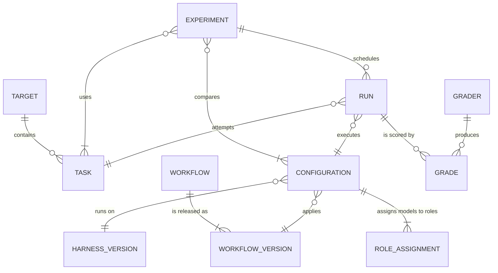
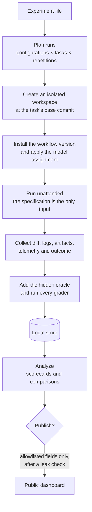

# Concepts and run lifecycle

> **Status:** Draft · **Last updated:** 2026-10-20 · **Owner:** Fabio Martins Barreto

This document defines the vocabulary used across the project and follows one run from the experiment file to the public dashboard.

## 1. Domain model



In one sentence: an **experiment** compares **configurations** on **tasks** taken from one or more **targets**; each combination is executed several times as **runs**, and **graders** score every run.

## 2. Glossary

### Target

A software project used as a testbed: a repository, an environment that can build and test it, and a set of tasks. Each target has a visibility class, **public** or **private**, which decides what may be published about it. Private targets appear in public material under a codename only ([D-013](../decisions/decision-log.md#d-013)).

The first target is **Target A**, a private B2B SaaS product with a Python/Django API and a Next.js web app.

### Task

A self-contained unit of work on a target.

| Part | Purpose | Visible to the agent? |
|---|---|---|
| Specification | The only instruction the agent receives: what to build and how it will be accepted | Yes |
| Base commit | The frozen repository state the run starts from | Yes |
| Interface contract | The names and signatures (modules, functions, API schema) that the hidden tests rely on; part of the specification | Yes |
| Environment and setup | Container image or setup commands needed to build and test the project | Yes |
| Hidden oracle | Acceptance tests derived from the specification | **No**: added only at grading time |
| Grading profile | Which graders run and with which settings | No |
| Metadata | Category, difficulty, expected size, task set (development or held-out) | No |

When a target has no suitable code for a task yet, a minimal scaffold is created and frozen as the base commit ([D-014](../decisions/decision-log.md#d-014)).

### Specification

The task's instruction document, for example a PRD with numbered acceptance criteria. Specifications are written and approved before any run and never change during an experiment. Writing them, including any interactive authoring, is not part of the measured run.

### Hidden oracle

Executable acceptance tests derived from the specification's acceptance criteria ([D-015](../decisions/decision-log.md#d-015)). Each test maps to one or more criteria, which makes the share of criteria satisfied measurable. A valid oracle fails on the base commit and passes on a reference solution, when one exists.

### Harness

The agent runtime that executes a run, pinned to an exact version, for example the Claude Code CLI. The early phases use Claude Code only ([D-017](../decisions/decision-log.md#d-017)); other harnesses can be added later through harness adapters.

### Workflow

The prompt layer under test: a versioned set of instructions and orchestration (plugin, commands, sub-agents, skills, system prompts) together with the knowledge of how to start it for a task. Examples:

- **relay**: the primary workflow under test.
- **vanilla**: the harness with no added prompts, given the specification with a fixed, minimal instruction. It is the baseline every workflow is compared against ([D-016](../decisions/decision-log.md#d-016)).
- **Other workflows**: for example `prp-core`, the upstream plugin that relay was forked from, other plugins, or a team's in-house prompt set.

### Workflow version

An immutable reference to a workflow's content, such as a git tag or commit SHA. Results are always attributed to a version, never to a workflow name alone.

### Workflow adapter

The integration that lets AI Track Record run a workflow. Adding a workflow means writing an adapter, not changing the core. An adapter declares:

1. **Source and pinning**: where versions come from and how a version is fixed.
2. **Installation**: how to load the workflow into the harness inside an isolated workspace.
3. **Roles**: which roles can receive their own model, and how a model assignment is applied.
4. **Entry point**: how to start the workflow unattended with the task's specification, answering or skipping any interactive step.
5. **Specification placement**: how the canonical specification is put where the workflow expects it. Adapters may change format and location, never content.
6. **Completion and outcome mapping**: how to detect the end of a run and map the workflow's own outcomes (for example relay's HALT codes) to normalized outcomes.
7. **Stage map** (optional): how to attribute time and tokens to stages such as planning, implementation, testing and review.
8. **Artifacts**: which workflow outputs to collect, such as plans, review logs and reports, and the run's changes as one patch against the base commit. That patch is all the verifier receives.

### Role

A function inside a workflow that can be served by its own model, for example planner, plan reviewer, implementer, code reviewer or test runner. Roles are declared by the workflow adapter. The vanilla workflow has a single role.

### Model assignment

The mapping from roles to models. A **single-model** assignment uses one model for every role; a **mixed** assignment uses different models for different roles.

### Provider route

How a model is reached: the provider's own API, an Anthropic-compatible endpoint offered by another provider, an LLM gateway (proxy), or a local inference server for open-weight models. The route is recorded with each run because it can affect cost, latency and behavior.

### Configuration

The complete, pinned definition of what is being evaluated:

```text
configuration = harness version
              + workflow version
              + model assignment, with provider routes
              + tools and context, such as MCP servers or retrieval   (later phases)
              + settings: effort, budget cap, time limit, turn limit
```

Every configuration has a stable identifier derived from its content, so identical configurations are recognized across experiments.

### Experiment

A declarative plan that answers one question. It names a hypothesis, a reference configuration, the configurations compared against it, the tasks, the number of repetitions and the limits. Experiments normally change one factor at a time. An illustrative example:

```yaml
# Illustrative only. The real format will be defined in the architecture documents.
id: relay-vs-vanilla
question: Does relay deliver more correct features than the plain agent with the same model?
hypothesis: relay raises the success rate by at least 20 points at less than 3x the cost.
reference:
  harness: claude-code@<pinned version>
  workflow: vanilla
  models: { all: claude-sonnet-5-5 }
compare:
  - workflow: relay@<git tag or commit SHA>   # everything else inherited from the reference
tasks: [target-a/task-01, target-a/task-02, target-a/task-03]
repetitions: 3
limits: { usd_per_run: 15, minutes_per_run: 120, usd_total: 250 }
```

### Run

One execution of one configuration on one task (one repetition) in a fresh, isolated workspace. A run produces the final diff against the base commit (the content of the pull request the agent would open), logs and transcripts, workflow artifacts, telemetry and an outcome.

### Outcome

How the run ended, as observed by the harness and the workflow, before any grading ([D-019](../decisions/decision-log.md#d-019)):

| Outcome | Meaning |
|---|---|
| `completed` | The workflow reported that it finished the task. |
| `halted` | The workflow stopped itself under its own rules. The native reason is kept, for example a relay HALT code. |
| `budget_exceeded` | The run hit its cost cap. |
| `timed_out` | The run hit its time or turn limit. |
| `error` | Infrastructure failure: harness crash, provider outage or broken environment. It does not count as a workflow failure and the run may be retried. |

The outcome records what the agent claims. The grades record what is true.

### Grader

A check that scores a run: the hidden oracle, the target's existing test suite, static analysis, an independent code review, an LLM judge or a human reviewer.

### Grade

The result of one grader on one run: pass or fail per acceptance criterion, findings with severity, or a rubric score.

### Scorecard

The aggregated metrics of one configuration across tasks and repetitions, with uncertainty intervals.

### Publication

A deliberate, versioned export of allowed data from the local store to the public dashboard. Every publication is recorded, so the public site can be traced back to the exact runs it was built from.

## 3. Run lifecycle



1. **Plan.** The experiment file expands into a list of runs: every configuration on every task, once per repetition. Runs that already exist with identical inputs are skipped, so an interrupted experiment can resume.
2. **Isolate.** Each run gets a fresh container with the task's environment and a single-commit copy of the base commit, so the agent cannot read later history. No state carries over between runs.
3. **Install.** The workflow adapter loads the pinned workflow version into the pinned harness and applies the model assignment.
4. **Execute.** The workflow runs without human input. Budget, time and turn limits are enforced from outside the agent.
5. **Collect.** The final diff, logs, transcripts, workflow artifacts and telemetry are saved, and the outcome is recorded.
6. **Grade.** The agent's changes move to a fresh environment, and only there is the hidden oracle added. The oracle, the target's existing tests, static analysis and the independent reviewer run; some runs are sampled for human review.
7. **Store.** Structured results go to the local database; raw artifacts stay on disk next to them.
8. **Analyze.** Runs are aggregated into scorecards and comparisons with uncertainty intervals.
9. **Publish.** On the operator's command, an exporter copies only the fields allowed for each target's visibility class into the static dashboard, after an automated leak check.

## 4. What stays fixed and what varies

Within one experiment:

| Fixed for every run | Varies by design |
|---|---|
| Task specifications, base commits, environments and hidden oracles | The one factor under study: model, model assignment, workflow version, workflow or harness |
| Budget, time and turn limits | The repetition index, to measure variance |
| Grader versions and settings | |
| The price table used to compute cost | |
