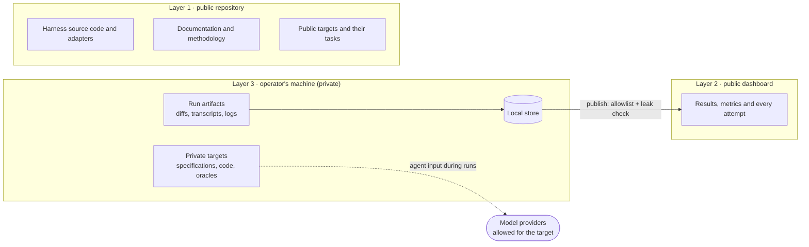

# Visibility and privacy

> **Status:** Draft · **Last updated:** 2026-10-20 · **Owner:** Fabio Martins Barreto

AI Track Record must publish convincing evidence even though part of that evidence comes from code that cannot be shown. This document defines where each kind of material lives and the rules that keep private material private.

## 1. Three layers

The product has three layers with different audiences ([D-002](../decisions/decision-log.md#d-002)).

| Layer | Audience | Contains | Never contains |
|---|---|---|---|
| **1. Public repository** | Anyone | Harness source code, adapters, documentation and methodology, public targets with their tasks, experiment files for public targets | Anything from private targets, personal data, secrets |
| **2. Public dashboard** | Anyone | Results, metrics and every attempt: full detail for public targets; per-run metrics and aggregates for private targets, under codename | Code, specifications, diffs, transcripts or rendered prompts from private targets |
| **3. Operator's machine** | The operator only | Everything else: private targets with their tasks and oracles, all run artifacts, the local store | — |

Private material leaves the operator's machine in one way only: as input to the model providers allowed for that target (see [section 4](#4-model-providers-and-private-code)).

## 2. What may be published

| Material | Public target | Private target |
|---|---|---|
| Target name | Real name | Codename only, for example "Target A" ([D-013](../decisions/decision-log.md#d-013)) |
| Target description | Full | Category, stack and size class, for example "B2B SaaS, Django + Next.js" |
| Task specification | Full text | Generic title, category and difficulty |
| Hidden oracle | Published after the experiment closes, except for held-out tasks ([D-023](../decisions/decision-log.md#d-023)) | Never |
| Base commit and reference solution | Full | Never |
| Diff produced by a run | Full | Never; size metrics only (files changed, lines added and removed) |
| Transcripts and logs | Full, after secret scrubbing | Never |
| Workflow source (prompts, commands, agents) | Full, if the workflow is public | Full, if the workflow is public: the workflow does not depend on the target |
| Prompts as rendered during a run | Full, after secret scrubbing | Never: they contain target content |
| Per-run metrics | Full | Full: outcome, grades, tokens, cost, time |
| Review findings | Full text | Category and severity only |

## 3. Publication rules

1. **Deny by default.** The exporter copies only the fields on the allowlist for the target's visibility class. A new field stays private until it is added to the list.
2. **Leak check before every publication.** The export is scanned for private identifiers: real names of private targets, file paths, code fragments, specification text and secrets. Any finding blocks the publication.
3. **Explicit and recorded.** Publishing is a deliberate command. Each publication records its date, the runs it includes and the version of the allowlist.
4. **No private material in the repository.** Private targets, their tasks and their run artifacts live outside the repository's tracked files.
5. **Secret scrubbing.** Transcripts and logs of public targets are scrubbed of keys, tokens and personal data before export.

## 4. Model providers and private code

Running an agent sends code and specifications to a model provider. For private targets this is the only way private material leaves the machine, so providers are allowed per target ([D-026](../decisions/decision-log.md#d-026)).

- Each target lists the providers and routes allowed to receive its content.
- AI Track Record refuses to start a run whose model assignment uses a provider that is not allowed for the target.
- Providers that may train on submitted content, or whose data handling does not meet the target owner's requirements, are not allowed on private targets. They can still be evaluated on public targets.
- Benchmark runs use API access meant for programmatic use, never consumer subscriptions or free tiers ([D-027](../decisions/decision-log.md#d-027)).

The providers allowed for Target A are still an open decision ([D-029](../decisions/decision-log.md#d-029)).

## 5. Verifiability without disclosure

Results on private targets cannot be checked line by line. AI Track Record makes them credible by:

- running the **same method** on a **public reference target** whose tasks, oracles and runs are fully inspectable ([D-012](../decisions/decision-log.md#d-012));
- publishing **every run** on private targets with its metrics, not only aggregates;
- describing private tasks by **category, difficulty and size**, so readers can judge what was measured;
- keeping the **harness, graders and methodology public**, so anyone can inspect how every number was produced.
