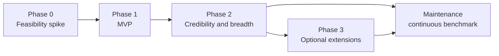

# Scope, roadmap and risks

> **Status:** Draft · **Last updated:** 2026-10-26 · **Owner:** Fabio Martins Barreto

AI Track Record is a bounded study that becomes a maintained benchmark ([D-039](../decisions/decision-log.md#d-039)). The MVP target date is the first week of December 2026 ([D-042](../decisions/decision-log.md#d-042)); if the MVP runs late, the date moves and the scope does not ([D-043](../decisions/decision-log.md#d-043)). The MVP scope is accepted and frozen ([D-024](../decisions/decision-log.md#d-024)). Phases 2 and 3 as a whole are still a **proposal**, although some Phase 2 items are already accepted decisions ([D-012](../decisions/decision-log.md#d-012), [D-021](../decisions/decision-log.md#d-021), [D-023](../decisions/decision-log.md#d-023)). The MVP budget is capped at US$ 800, with a target of US$ 400 set at M0 ([D-028](../decisions/decision-log.md#d-028)); the Phase 2 budget is open ([D-044](../decisions/decision-log.md#d-044)).

## 1. Phases at a glance

| Phase | Purpose | Exit criterion |
|---|---|---|
| **0. Feasibility spike** | Prove that a task can run unattended end to end, with full telemetry and grading | One relay run and one vanilla run on the synthetic task, graded by a hidden oracle, with reconciled cost |
| **1. MVP** | Publish the first trustworthy results | The MVP success criteria below are met and the dashboard is public |
| **2. Credibility and breadth** | Make results verifiable and compare more dimensions | A public reference target, mixed model assignments and non-Anthropic models are on the dashboard, and the findings are published |
| **3. Optional extensions** | Study further questions, chosen after Phase 2 | Each chosen extension is published with a write-up |
| **Maintenance** | Keep the record current with low, predictable effort | Ongoing: relevant releases are benchmarked and published |

The study ends when Phase 2 closes or, if extensions are chosen, when Phase 3 closes. From then on the project is in maintenance.

## 2. Phase 0: feasibility spike

The spike answers the technical unknowns before any work on the dashboard. It uses a small synthetic task ([D-046](../decisions/decision-log.md#d-046)), so it does not depend on the provider decision for Target A ([D-029](../decisions/decision-log.md#d-029)). The [Phase 0 plan](../plans/phase-0.md) breaks it into work packages.

- Can relay's autonomous pipeline run with no human input, including its precondition checks?
- Can every sub-agent be forced to use the model under test, even when its prompt names a fixed model?
- Are tokens, cost and time captured for the orchestrator *and* for every sub-agent?
- Does Harbor, the chosen runner ([D-030](../decisions/decision-log.md#d-030)), pass the [Phase 0 checks](../research/phase-0-tooling.md#7-phase-0-checks)? If not, a minimal custom container runner replaces it.
- What do real runs cost? Three pilot runs (relay with a small model, relay with a mid-size model, vanilla with a mid-size model) calibrate the budget.

## 3. Phase 1: MVP

**Accepted and frozen on 2026-10-20** ([D-024](../decisions/decision-log.md#d-024)). Additions go to a later phase, and any change needs a new decision.

| Dimension | MVP scope |
|---|---|
| Workflows | relay (current release and an earlier release) and the vanilla baseline. Vanilla is built as a second adapter, which proves the workflow abstraction from the start ([D-016](../decisions/decision-log.md#d-016)). |
| Harness | Claude Code, pinned version |
| Models | Claude Haiku, Sonnet and Opus (current versions at experiment time), in single-model assignments |
| Target | Target A (private) |
| Tasks | Three backend tasks of increasing difficulty, each with a hidden oracle |
| Repetitions | 3 per configuration and task |
| Graders | Hidden oracle, existing tests, static analysis, and an independent review with human confirmation on a sample |
| Dashboard | Static site with headline answers, the cost-versus-quality chart, the run explorer, the task catalog and the methodology |
| Communication | One write-up in the form "measured X, found Y, changed Z" |

### MVP experiment design

Five configurations, each differing from the reference in one factor:

| Configuration | Workflow | Model | Question it answers |
|---|---|---|---|
| **Reference** | relay, current release | Sonnet | — |
| Smaller model | relay, current release | Haiku | How much quality is lost, and how much money saved, with a smaller model? |
| Larger model | relay, current release | Opus | Does a larger model pay for itself? |
| Earlier release | relay, earlier release | Sonnet | Did recent workflow changes help? |
| Baseline | vanilla | Sonnet | Is the workflow worth its cost? |

Three tasks × five configurations × three repetitions = **45 runs**, plus pilot runs and retries.

### Not in the MVP

- Workflows other than relay and vanilla. The adapter contract keeps them possible ([D-006](../decisions/decision-log.md#d-006)).
- Mixed model assignments and models from other providers.
- A public reference target (planned for Phase 2).
- The LLM judge and mergeability verdicts.
- Frontend tasks.

### MVP success criteria

| ID | Criterion |
|---|---|
| SC-1 | At least 45 runs completed unattended, each with outcome, grades, tokens, cost and time. |
| SC-2 | Every number on the dashboard links to the runs it was computed from. |
| SC-3 | Computed cost matches billed cost within ±10% at experiment level. |
| SC-4 | Re-running one configuration reproduces its success rate within the published interval. |
| SC-5 | In an informal test, three qualified readers each answer the headline questions from the dashboard in under five minutes. |
| SC-6 | No private material in any publication, confirmed by the leak check and a manual audit. |

## 4. Schedule to the MVP

Planning assumes 10–15 hours of operator time per week. The target dates below are reachable only near the top of that range and the low end of the effort estimate, so they are checkpoints, not promises.

| Milestone | Done when | Effort | Target date |
|---|---|---|---|
| **M0. Phase 0 exit** | One relay run and one vanilla run on a small public or synthetic task are graded by a hidden oracle, with reconciled cost. The provider decision for Target A is made ([D-029](../decisions/decision-log.md#d-029)), and the MVP budget ceiling is re-evaluated with the pilot costs ([D-028](../decisions/decision-log.md#d-028)). | 15–20 h | 2026-11-03; **reached 2026-10-23** |
| **M1. Tasks frozen** | Target A's scaffold, base commits, three specifications and their validated oracles are ready | 25–40 h | 2026-11-17; **reached 2026-10-25** |
| **M2. Harness complete** | Graders, local store and exporter work end to end, and the pilot runs are done | 20–30 h | 2026-11-24 |
| **M3. Runs graded** | All MVP runs are executed, graded and analyzed | 5–8 h, plus 1–2 days of machine time | 2026-11-30 |
| **M4. MVP public** | The dashboard is published and the write-up is out | 15–22 h | 2026-12-04 |

Total: 80–120 hours, the same as the [estimate](#8-effort-and-cost-estimates).

**Forecast.** At 15 hours per week with effort near the low end, M4 lands in the first week of December. At 12 hours per week with mid-range effort, it lands in mid-December. At 10 hours per week with effort at the high end, it lands in January.

**Re-forecast at M0 (2026-10-23).** Phase 0 ended 11 days before its target date. The later dates stay as they are, and the 11 days are kept as buffer. The order of the milestones does not change. M2 gains three small items from M0:

- the network allowlist and disabled web tools for Target A ([D-050](../decisions/decision-log.md#d-050));
- the skipped-step flag ([D-051](../decisions/decision-log.md#d-051));
- the harness fixes found in Phase 0: worktree collection on a timeout, cleanup after a killed job, and a Collector check before each run.

Together they add an estimated 4–8 hours, which the buffer covers. The API credits left at M0, about US$ 94, expire on 2026-11-03 before any Target A task exists. The runs draw on the following billing cycles instead.

**Re-forecast at M1 (2026-10-25).** M1 ended 23 days before its target date ([M1 results](../research/m1-results.md)). The later dates stay as they are, and the buffer grows to 23 days. The network allowlist in Target A's task templates, one of the M2 items above, was done in M1; disabling the web tools stays in M2. The M2 pilots check both whether the tasks separate the configurations and what they cost: their reference changes are several times the size of the synthetic task's.

**Checkpoint rule.** At each milestone, the remaining work is re-estimated with real data and the MVP date is re-forecast. If a milestone slips, the date moves and the accepted scope stays ([D-043](../decisions/decision-log.md#d-043)).

## 5. Phase 2: credibility and breadth

Candidates:

- A **public reference target** with fully inspectable tasks, oracles and runs ([D-012](../decisions/decision-log.md#d-012)).
- About five tasks, including frontend work, and a **held-out task set** ([D-023](../decisions/decision-log.md#d-023)).
- **Mixed model assignments**, with a different model per role.
- **Models from other providers and open-weight models**, through compatible endpoints or a gateway, labeled as workflow-portability results.
- An **LLM judge** with mergeability verdicts, calibrated against human grades.
- **Workflow version history** on the dashboard, with prompt diffs next to the measured effects.
- Two or three more write-ups.

## 6. Phase 3: optional extensions

Phase 3 happens only for the extensions chosen after Phase 2. None of them is needed for the study to be complete.

- **Other workflows** through adapters, for example the upstream `prp-core` plugin, other Claude Code plugins or in-house prompt sets.
- **Other harnesses**, for example other coding-agent CLIs.
- **Tools and context as variables**, such as retrieval over project documentation (RAG) or MCP servers.
- **Exploratory:** applying the same method to LLM-powered features inside a product, not only to coding agents ([D-037](../decisions/decision-log.md#d-037)).

## 7. Maintenance: continuous benchmark

Once the study closes, the project is kept current without new features.

- **Trigger:** a relevant new model from a provider already in the benchmark, or a new relay release that changes its prompts.
- **Round:** one new configuration is added to the reference experiments and run on the reference tasks with the standard repetitions, then graded and published.
- **Effort:** new runs with existing tasks and graders. Only fixes are made to the code.
- **Timeliness:** each round is published within an agreed time after the release, for example one month.

## 8. Effort and cost estimates

Order-of-magnitude estimates from the planning analysis of 2026-10-19. They assume light, medium and heavy token profiles per run and list prices from October 2026, and they will be recalibrated after the Phase 0 pilot runs.

| | MVP | Through Phase 2 | With Phase 3 extensions | Each maintenance round |
|---|---|---|---|---|
| Runs | ~45, plus pilot runs and retries | ~160 | ~400 | ~9–15 |
| Operator effort | 80–120 h | 200–300 h | 400–550 h | ~2–6 h |
| Machine time | 60–90 h | 200–300 h | 500–730 h | ~10–20 h |
| Model API spend (light – heavy) | US$ 260–1,340 (central ~US$ 600) | US$ 1,000–5,200 (central ~US$ 2,300) | US$ 2,500–12,900 (central ~US$ 5,700) | ~US$ 20–350, depending on the model |
| Infrastructure | Static hosting (about US$ 0) and a domain | Same | Plus GPUs if open-weight models run locally | Same |

Machine time is the sum of run durations; running two or three runs in parallel shortens the calendar time.

**MVP budget ceiling:** US$ 800, including pilot runs and retries ([D-028](../decisions/decision-log.md#d-028)). It covers the central estimate with a margin of about a third, but not the heavy-run scenario. **Target, set at M0:** US$ 400. It is a goal that spend may pass, up to the ceiling. The Phase 0 pilots put the 45 runs at about US$ 105 if Target A's tasks were the size of the synthetic task ([M0 review](../research/phase-0-results.md#m0-review)). The M2 pilots on Target A's tasks raise that to about US$ 470, or about US$ 520 with retries: above the target, under the ceiling ([M2 budget check](../research/m2-results.md#budget-check)). The Max plan's included API credits, US$ 100 a month, pay first ([D-049](../decisions/decision-log.md#d-049)).

Ways to keep spend down:

- Develop and debug the harness with the cheapest model.
- Spread runs across billing cycles, so each month's included credits are used before they expire.
- Change one factor at a time instead of running every combination.
- Start with 3 repetitions and add more only for close finalists.
- Prefer small tasks; a single-phase task costs about half as much as a medium one.
- Run providers with off-peak pricing during off-peak hours, on public targets only.

## 9. Risks and mitigations

| # | Risk | Impact | Mitigation |
|---|---|---|---|
| R1 | **Scope creep**: the operator has limited time and other commitments | The MVP never ships | The MVP scope is frozen ([D-024](../decisions/decision-log.md#d-024)); milestone checkpoints re-forecast the date; new ideas go to later phases. Because the date moves before the scope does ([D-043](../decisions/decision-log.md#d-043)), the freeze is the main defense. |
| R2 | **Noisy results**: agents are non-deterministic and samples are small | Wrong conclusions | Repetitions, uncertainty intervals, one factor at a time, preliminary labels |
| R3 | **Weak or biased oracles**: tests that are too lenient, too strict or tied to one implementation | The success rate means little | Interface contract in the specification; task validity check; oracles reviewed before use |
| R4 | **Overfitting the workflow**: the operator tunes relay on the tasks that judge it | Inflated relay results | Held-out task set; full version history; public reference target |
| R5 | **Conflict of interest**: the operator writes the main workflow under test | Readers distrust the results | Independent graders; full record; hypotheses declared before running; public methodology |
| R6 | **Budget overrun** | Experiments stop half-way | US$ 800 MVP ceiling and a US$ 400 target, checked again at M2 ([D-028](../decisions/decision-log.md#d-028)); caps per run and per experiment; development on the cheapest model; pre-run estimates (Phase 2) |
| R7 | **Private data leak** | Harm to the private target's owner; loss of trust | Allowlist export; leak check; allowed providers per target; codenames; private material outside the repository |
| R8 | **Provider terms**: consumer subscriptions restrict automated use | Account or legal risk | Benchmark runs use API access meant for programmatic use ([D-027](../decisions/decision-log.md#d-027)) |
| R9 | **Unsupported routes**: running non-Claude models inside Claude Code is not officially supported, and relay is tuned for Claude | Unfair or misleading comparisons | Such results are labeled as workflow portability and never presented as model rankings |
| R10 | **Ecosystem churn**: harness versions, models and prices change often | Results stop being comparable over time | Pinned versions; price tables recorded with runs; cost recomputed from tokens |
| R11 | **Supply-chain compromise**: AI gateways and evaluation libraries have been targeted in 2026 | Stolen credentials or tampered results | Pinned and verified dependencies; least-privilege API keys per experiment |
| R12 | **Harness changes break unattended mode** | Runs fail for infrastructure reasons | Pinned harness version; Phase 0 spike; `error` outcomes kept apart from workflow failures |
| R13 | **Secondary objectives pull focus**: building Target A features, improving relay or trying new tools crowds out the study | The MVP slips, or tasks are chosen for the product instead of the benchmark | The [conflict rules](01-vision-and-scope.md#64-when-objectives-conflict): the primary purpose wins and nothing is broadened before the MVP is public |
| R14 | **Provider approval for Target A is pending**: it is not yet confirmed that Target A's content may be sent to the planned model provider | The MVP cannot start on Target A | Phase 0 uses a public or synthetic task; resolved on 2026-10-22: Anthropic models are allowed ([D-029](../decisions/decision-log.md#d-029)) |
